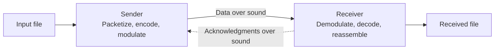

# SoundLink

SoundLink is an acoustic modem that sends a file between two computers through their speakers and microphones. It turns file data into audio and sends acknowledgments back over the same acoustic link, so a transfer can run without Wi-Fi or Bluetooth.

The modem is written in C++17 and uses miniaudio for audio input and output. The sender and receiver are Python command-line tools that call the modem through SWIG bindings.

## How it works



1. **Handshake.** The sender announces the file name and size. The two sides synchronize their audio timing, and the receiver sends the transfer channel settings from [`apps/transfer.json`](apps/transfer.json).
2. **Transfer.** The sender splits the file into numbered segments and transmits them across configurable audio channels using orthogonal frequency-division multiplexing (OFDM). Error-correcting codes help recover data from noisy signals, and the receiver sends acknowledgments in separate time slots so the sender can retry missing segments.
3. **Close.** Once every segment is acknowledged, the sender requests closure. The receiver saves the reconstructed file under its original name and confirms completion.

## Quick start

Build from the repository root on each computer. The Makefile supports macOS and Linux. You’ll need `make`, a C++17 compiler, Python 3 with development headers, and SWIG. If SWIG is missing, `make` uses Python’s `pip` to install it locally under `build/`.

```sh
make
```

Use two nearby computers with working speakers and microphones. Both computers need audio input and output because acknowledgments travel back as sound. Start the receiver first, then send a small file from the other computer.

```sh
# On the receiving computer
mkdir -p received
python3 apps/receiver.py received

# On the sending computer
python3 apps/sender.py path/to/file.txt
```

Both terminals show transfer progress and signal-to-noise estimates for their receive channels. Files can be up to 10 MiB.

## Technical reference

### Choosing transfer channels

Edit [`apps/transfer.json`](apps/transfer.json) on the receiving computer before starting `receiver.py`. During the handshake, the receiver sends this channel plan to the sender, which applies it when it enters the transfer state.

- `data` lists the channels the sender uses to transmit file segments in parallel. The supplied plan uses 3, 6, and 9 kHz centers.
- `control` lists the channels the sender uses for control messages such as timing adjustments and transfer closure. The supplied plan uses a 17 kHz center. The receiver sends acknowledgments on a fixed 15 kHz return channel with 3 kHz bandwidth, QPSK, and a `1/2` code rate.

Each channel takes four settings.

| Field | Accepted values |
| --- | --- |
| `center_khz` | Integer from `2` to `18`, inclusive |
| `bandwidth_khz` | `1.4`, `3`, `5`, `10` |
| `modulation` | `"BPSK"`, `"QPSK"`, `"16QAM"`, `"64QAM"` |
| `code_rate` | `"1/2"`, `"2/3"`, `"3/4"`, `"5/6"`, `"7/8"` |

For example, this plan uses one data channel and one forward control channel.

```json
{
  "data": [
    {"center_khz": 3, "bandwidth_khz": 3, "modulation": "QPSK", "code_rate": "3/4"}
  ],
  "control": [
    {"center_khz": 17, "bandwidth_khz": 1.4, "modulation": "QPSK", "code_rate": "1/2"}
  ]
}
```

Choose non-overlapping bands for the channels that transmit together. Each band is centered on `center_khz` and extends half its bandwidth on either side. Higher-order modulation carries more bits per symbol and needs a cleaner signal. Lower code rates add more error-correction redundancy.

The modem uses 48 kHz mono audio and time-division duplexing. During transfer, three sender slots alternate with one receiver slot. The physical layer uses BCH and convolutional coding with interleaving, and the data-link layer checks packets with CRC-32C.
